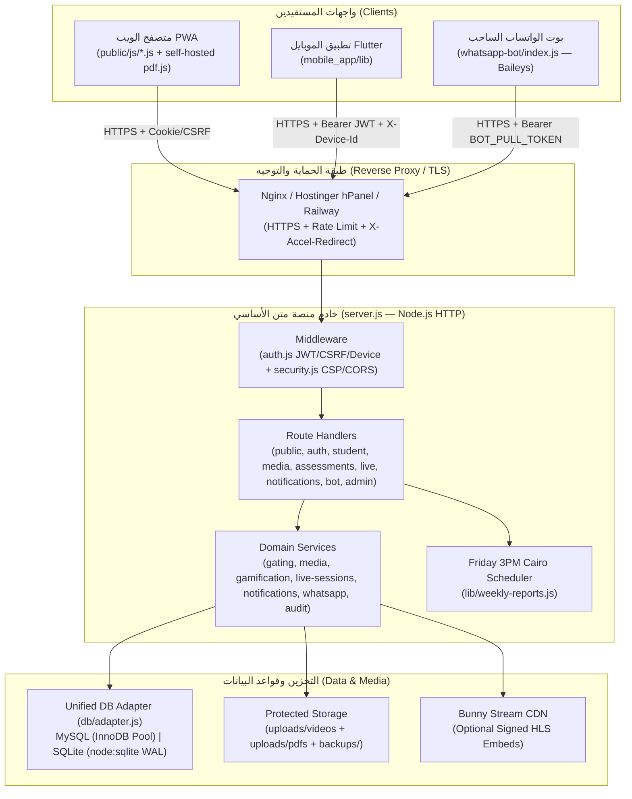

# 🕌 منصة مَتْن (MATN) التعليمية — Al-Sheikh Islamic Studies LMS

**منصة تعليمية متكاملة ومؤمّنة لتدريس المواد الشرعية للأزهر الشريف | Enterprise Azhari Sharia E-Learning Platform**

[-339933?logo=node.js&logoColor=white)](https://nodejs.org/)
[%20%7C%20SQLite%20(WAL)-4479A1?logo=mysql&logoColor=white)](https://www.mysql.com/)
[-02569B?logo=flutter&logoColor=white)](https://flutter.dev/)
[-25D366?logo=whatsapp&logoColor=white)](./whatsapp-bot/README.md)
[](#-%D8%A7%D9%84%D8%A7%D8%AE%D8%AA%D8%A8%D8%A7%D8%B1%D8%A7%D8%AA-%D8%A7%D9%84%D8%A3%D9%85%D9%86%D9%8A%D8%A9-security-test-suite)

> **منصة مَتْن (MATN)** هي نظام إدارة تعلم (LMS) متكامل لفضيلة الأستاذ **محمد عبد الله** لتدريس المواد الشرعية للأزهر الشريف (الإعدادية والثانوية)، مبني بدون اعتماديات طرف ثالث ثقيلة على الخادم (`mysql2` فقط على Node.js القياسي)، مع حماية صارمة للمحتوى، اشتراكات بالكود الشهري، بوابة حصص متسلسلة عبر الامتحانات، وتطبيق موبايل Flutter، وبوت واتساب ساحب (Pull-Worker) لتقارير أولياء الأمور كل جمعة.

---

## 📚 المراحل والمواد الدراسية المدعومة (Curriculum Coverage)

| المرحلة | الصفوف (`grade`) | الشعب (`branch`) | المواد المقررة (`subject`) |
| :--- | :--- | :--- | :--- |
| **الإعدادية الأزهرية** | `prep_1`, `prep_2`, `prep_3` | موحّد (`general`) | الفقه (`fiqh`) • التفسير (`tafseer`) • الحديث (`hadith`) • التوحيد (`tawheed`) • السيرة (`seerah`) • التجويد (`tajweed`) |
| **الثانوية (الأول والثاني)** | `grade_1`, `grade_2` | علمي (`scientific`) / أدبي (`literary`) / كلاهما (`both`) | الفقه الشافعي (`fiqh`) • الحديث (`hadith`) • التوحيد (`tawheed`) • التفسير (`tafseer`) |
| **الثانوية (الثالث الثانوي)** | `grade_3` | علمي (`scientific`) / أدبي (`literary`) / كلاهما (`both`) | الفقه الشافعي (`fiqh`) • الحديث (`hadith`) • التوحيد (`tawheed`) • التفسير (`tafseer`) • **المواريث** (`mawareeth`) |

---

## 🏗️ البنية المعمارية للنظام (System Architecture)



---

## 🧩 الوحدات الرئيسية (Core Modules)

- **المصادقة وربط الأجهزة (`routes/auth.js`, `middleware/auth.js`):**
  - تشفير كلمات المرور ورموز OTP باستخدام `scrypt` مع طابور تزامن محدود (`runBoundedScrypt`) وتكافؤ التوقيت (`DUMMY_HASH`).
  - جلسات JWT (`HS256`) + توكن CSRF مزدوج عبر الكوكيز + ربط معرف الجهاز (`X-Device-Id` / `matn_device_binding`) ورصد الأجهزة المشتركة (`SHARED_DEVICE_DETECTED`).
  - حماية ضد هجمات التخمين عبر قفل `(ip_address, phone)` في جدول `login_attempts` لمدة 30 دقيقة دون تعطيل دخول الطالب الشرعي من شبكات أخرى.
- **بوابة الاشتراكات والأكواد (`routes/auth.js`, `routes/admin.js`, `services/gating.js`):**
  - توليد أكواد تفعيل (`MATN-<days>D-<HEX>`) شاملة (`all`) أو مخصصة لمادة/صف مع إمكانية الحجز المسبق وقفل الكود برقم هاتف طالب محدد (`restrict_to_phone`).
  - دعم اشتراكات متعددة لكل مادة (`user_subject_subscriptions`) إلى جانب الاشتراك الشامل (`all`).
- **نظام الحصص المتسلسلة والاختبارات (`routes/assessments.js`, `services/gating.js`):**
  - بوابة متسلسلة متعدية (`evaluatePrecedingLessonsGate`): لا تُفتح الحصة التالية إلا بعد حل واجب الحصة السابقة واجتياز امتحانها بنسبة **فوق النصف** (`score > totalPoints / 2`).
  - أسئلة اختيار من متعدد (`mcq`) وصح/خطأ (`true_false`)، خلط عشوائي للأسئلة والاختيارات، مؤقت خادمي (`assessment_sessions`)، وإغلاق تلقائي للجلسات المنتهية بدرجة صفر، مع امتحان إعادة مخصص للراسبين (`retake_exam`).
- **البث الآمن للمحاضرات والمذكرات (`routes/media.js`, `services/media.js`):**
  - تذاكر بث موقّعة ومؤقتة (`3600` ثانية) مرتبطة بالمستخدم والدرس والجهاز، وبث نطاقات HTTP `206 Partial Content` أو `X-Accel-Redirect` عبر Nginx.
  - إعادة تموضع ذرة `moov` تلقائياً في ملفات MP4 (`relocateMoovToFront` / `qt-faststart`) لبدء التشغيل الفوري، ودعم Bunny Stream الموقّع، وعرض PDF عبر `pdf.js` المستضاف محلياً مع علامة مائية باسم الطالب ورقمه.
- **المتابعة، التلعيب، والبث المباشر (`routes/student.js`, `routes/live.js`, `routes/notifications.js`):**
  - تتبع نسبة مشاهدة الفيديو واستئناف التشغيل (`lesson_progress`)، ملاحظات الطالب الموقوتة بالثانية (`lesson_notes`)، بنك الأخطاء الذكي (`/api/student/mistakes`)، الأسئلة والأجوبة المعتمدة (`lesson_questions`)، لوحة الشرف (`honor_roll`)، سلسلة المذاكرة والأوسمة (`study_activity`)، الإشعارات المستهدفة، والحصص المباشرة مع سجل الحضور.
- **بوت واتساب الساحب وتقارير الجمعة (`routes/bot.js`, `lib/weekly-reports.js`, `whatsapp-bot/`):**
  - جدولة تلقائية كل جمعة الساعة 3:00 عصراً بتوقيت القاهرة (`Africa/Cairo`)، مع واجهة `/api/bot/weekly-reports/*` بنظام الاستحواذ الذري (`claim` + مهلة 5 دقائق) لبوت Baileys المحلي على جهاز المعلم لإرسال التقارير بأمان وتأخير متدرج ضد الحظر.

---

## ⚙️ المتطلبات التشغيلية والتشغيل السريع (Quick Start)

### المتطلبات (Prerequisites)
- **Node.js:** `>= 20.0.0` (مع MySQL) أو `>= 22.13.0` (لتشغيل SQLite المدمج `node:sqlite` محلياً وفي الاختبارات).
- **MySQL 8 / MariaDB:** قاعدة البيانات الافتراضية لبيئة الإنتاج (`DB_CLIENT=mysql`).
- **Flutter SDK:** `>= 3.2.0` (اختياري، لبناء تطبيق Android / iOS من مجلد `mobile_app/`).

### التشغيل المحلي للتطوير (Local Development)

```bash
# 1. تثبيت الاعتماديات
npm install

# 2. إنشاء ملف البيئة (أو نسخ .env.example وتعديله لوضع development + sqlite)
cp .env.example .env
# للتطوير المحلي بدون MySQL اضبط داخل .env:
# NODE_ENV=development
# DB_CLIENT=sqlite
# ALLOW_UNVERIFIED_REGISTRATION=true

# 3. تطبيق ترحيلات قاعدة البيانات والفهارس (14 ترحيلاً)
npm run db:migrate

# 4. (اختياري - للتطوير فقط) إضافة منهج تجريبي
npm run seed:dev

# 5. إنشاء حساب الإدارة الأول (كلمة المرور 12 حرفاً على الأقل)
INITIAL_ADMIN_PHONE=01012345678 INITIAL_ADMIN_PASSWORD="StrongAdminPassword123!" npm run setup:admin

# 6. فحص الجاهزية وتشغيل الخادم
npm run preflight -- --dev
npm run dev
```

سيعمل الخادم على: `http://localhost:4000`

---

## 🧪 الاختبارات الأمنية (Security Test Suite)

يحتوي المشروع على حزمة اختبارات شاملة (`tests/security.test.js`) تغطي 48 سيناريو أمني ووظيفي (المصادقة، JWT، CSRF، ربط الأجهزة، عزل الصفوف والشعب، التسليم المتزامن للامتحانات، البث الجزئي 206، الأكواد، وبوت السحب).

```bash
npm test
```

---

## 📖 التوثيق الهندسي الكامل (Documentation Suite)

| المستند | المحتوى |
| :--- | :--- |
| [ARCHITECTURE.md](docs/ARCHITECTURE.md) | البنية التحتية، تدفق البيانات، مخطط قاعدة البيانات الكامل (ER Diagram)، مصفوفة الصلاحيات (RBAC)، وملف الحماية (OWASP). |
| [MODULES_GUIDE.md](docs/MODULES_GUIDE.md) | الشرح التفصيلي لكل وحدة برمجية، القواعد الرياضية والحسابية، دورة حياة الاختبارات والأكواد، ومرجع نقاط النهاية (API Reference). |
| [DEPLOYMENT_GUIDE.md](docs/DEPLOYMENT_GUIDE.md) | دليل النشر الإنتاجي على Hostinger hPanel (MySQL + Node.js)، Ubuntu VPS (Nginx + Certbot + PM2)، Docker، وRailway، مع النسخ الاحتياطي وبوت الواتساب. |
| [DEVELOPER_HANDOVER.md](docs/DEVELOPER_HANDOVER.md) | دليل استلام المشروع للمطور الجديد: معايير الكود، محوّل قاعدة البيانات الموحد، أوامر CLI، ودورة العمل وحل الأعطال. |

---

## 🔒 السياسات الأمنية الأساسية

1. لا يحتوي النظام على أي حساب أدمن افتراضي مزروع في الكود؛ يتم إنشاؤه فقط عبر `npm run setup:admin` أو متغيرات `INITIAL_ADMIN_*` عند خلو قاعدة البيانات.
2. في بيئة الإنتاج (`NODE_ENV=production`) يرفض الخادم الإقلاع بدون `JWT_SECRET` بطول 32 حرفاً على الأقل.
3. ملفات `.env` ومجلدات `uploads/` و`backups/` و`whatsapp-bot/auth_info/` مستبعدة تماماً من Git عبر `.gitignore`.
