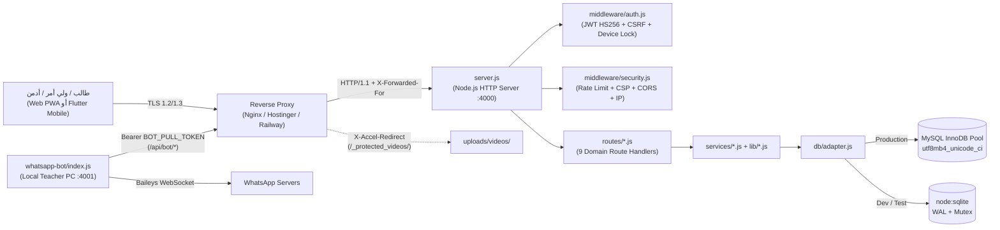
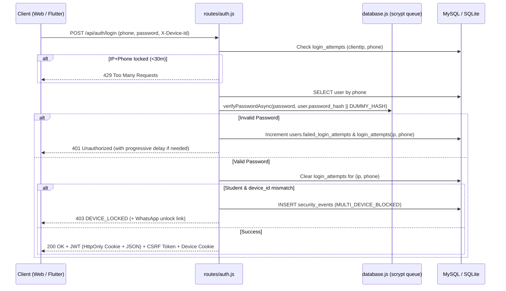
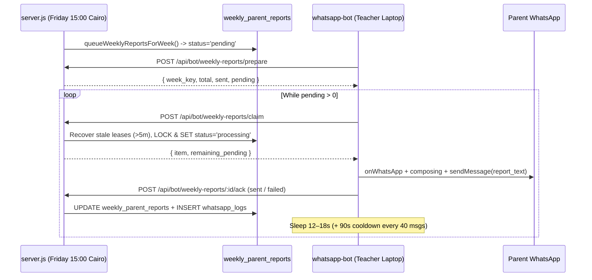
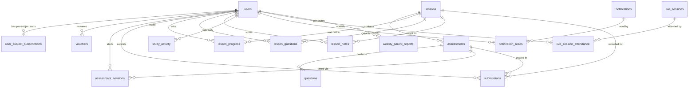

# 🏛️ البنية المعمارية للنظام (System Architecture)

## 1. الطوبولوجيا العامة (System Topology)

تم تصميم منصة **مَتْن (MATN)** كمعمارية خادم Node.js أحادي العملية منخفض الاعتماديات (`node:http`, `node:crypto`, `node:sqlite`, `mysql2`) لتحقيق أقصى استقرار وأداء على استضافات **Hostinger Shared/Managed Node.js** أو **Ubuntu VPS** مع خدمة مئات الطلاب المتزامنين (700+ طالب).

### لماذا عملية واحدة (`instances: 1`) في حالة SQLite؟
- في بيئة الإنتاج على MySQL، تعتمد المعاملات الحرجة على أقفال الصفوف (`SELECT ... FOR UPDATE`) وقفل الهجرات الموزع (`GET_LOCK('matn_migrate', 30)`).
- حالياً، تُخزَّن حالة تحديد المعدل (`rateLimitStore`) وجلسات الرفع المجزأ (`activeUploads`) في الذاكرة المحلية للعملية؛ لذلك يُضبط `deploy/ecosystem.config.js` على `instances: 1` لضمان اتساق الذاكرة المحلية، وهو ما يكفي بسهولة لأكثر من 700 طالب متزامن بفضل التدفق غير المتزامن (`streamFileWithRange`) وتقييد عمليات `scrypt` المتزامنة (`MAX_CONCURRENT_SCRYPT`).

---

## 2. تدفق البيانات الأساسي (Core Data Flows)

### أ. تدفق تسجيل الدخول وحماية الجلسة (Auth & Device Binding Flow)

### ب. تدفق سحب تقارير الجمعة عبر بوت الواتساب (Pull-Worker Flow)

---

## 3. مخطط قاعدة البيانات (Database Schema & ER Diagram)

يتطابق المخطط عبر 14 ترحيلاً في `db/migrations.js` لكلا المحركين: **MySQL (InnoDB, `utf8mb4_unicode_ci`)** و**SQLite (`node:sqlite` WAL)**.

### ملخص الجداول الـ 23 (Tables Inventory)

| الجدول | الغرض الأساسي |
| :--- | :--- |
| `schema_migrations` | تتبع الترحيلات المطبقة (`version`, `name`, `applied_at`). |
| `users` | حسابات الطلاب والإدارة، التحقق بالواتساب، بصمة الجهاز، عدادات القفل، وتاريخ انتهاء الاشتراك العام. |
| `user_subject_subscriptions` | الاشتراكات المنفصلة لكل مادة (`PRIMARY KEY (user_id, subject)`). |
| `vouchers` | أكواد التفعيل، النطاق (`subject_scope`, `grade_scope`)، السعر، الحجز المسبق، وقفل الهاتف (`restrict_to_phone`). |
| `lessons` | المحاضرات، الترتيب (`order_index`)، المرحلة/الشعبة، نوع الفيديو (`upload`/`bunny`)، وملف/بيانات المذكرة. |
| `assessments` | الواجبات (`homework`)، الامتحانات (`exam`)، وامتحانات الإعادة (`retake_exam`) ومواعيدها والطلاب المستهدفين. |
| `questions` | بنوك الأسئلة (`mcq` أو `true_false`)، وسم المبحث (`topic_tag`)، التعليل، والدرجة. |
| `assessment_sessions` | الجلسات الموقوتة الخادمية (`started_at`, `expires_at`, `submitted_at` بـ epoch ms). |
| `submissions` | نتائج التسليم، الدرجة، الاجتياز (`passed`)، نقاط القوة والضعف، وتفاصيل المراجعة (`answers_json`). |
| `lesson_progress` | تقدم مشاهدة الفيديو (`last_position_seconds`, `duration_seconds`, `max_watched_percent`). |
| `lesson_questions` | أسئلة الطلاب على الدروس وإجابات الأستاذ المعتمدة للنشر (`is_published`). |
| `lesson_notes` | ملاحظات الطالب الشخصية المرتبطة بثانية محددة من الفيديو (`timestamp_seconds`). |
| `study_activity` | سجل النشاط اليومي بتوقيت القاهرة لحساب سلسلة المواظبة (`study_streak`). |
| `notifications` | الإشعارات والتنبيهات العامة أو الموجهة لصف/شعبة/طالب محدد. |
| `notification_reads` | حالة قراءة الإشعارات لكل طالب (`PRIMARY KEY (notification_id, user_id)`). |
| `live_sessions` | جدول الحصص المباشرة (`zoom`, `youtube`, `meet`, `other`) ومواعيد الفتح المبكر. |
| `live_session_attendance` | تسجيل حضور الطالب الفعلي عند ضغط الانضمام (`UNIQUE(live_session_id, user_id)`). |
| `weekly_parent_reports` | طابور تقارير الجمعة لولي الأمر مع آلية الاستحواذ (`status`, `claimed_at`, `attempt_count`). |
| `whatsapp_logs` | سجل محاولات إرسال رسائل الواتساب وحالتها (`pending`, `sent`, `failed`). |
| `security_events` | تنبيهات الأمان (تعدد الأجهزة، محاولات تخمين على الأدمن، محاولات التصوير/DevTools). |
| `audit_logs` | سجل التدقيق الكامل لجميع أفعال الإدارة والحسابات والأكواد مع IP الفاعل. |
| `login_attempts` | تتبع محاولات الدخول الفاشلة لكل زوج `(ip_address, phone)` لقفل المهاجم فقط. |
| `platform_settings` | إعدادات المنصة العامة والخاصة (فودافون كاش، إنستاباي، تاريخ الامتحان، لوحة الشرف، إلخ). |

---

## 4. مصفوفة الصلاحيات (RBAC Permissions Matrix)

| الإجراء / المورد | زائر (`Anonymous`) | طالب غير مفعّل | طالب مفعّل ومرتبط بجهاز | بوت الواتساب (`BOT_PULL_TOKEN`) | الأدمن (`admin`) |
| :--- | :---: | :---: | :---: | :---: | :---: |
| `/api/health` & `/api/public/info` | ✅ | ✅ | ✅ | ✅ | ✅ |
| تسجيل الدخول / التسجيل / طلب فك الجهاز | ✅ | ✅ | ✅ | ❌ | ✅ |
| تفعيل كود شحن (`/api/vouchers/redeem`) | ❌ | ❌ (يلزم تفعيل الحساب) | ✅ | ❌ | ✅ |
| لوحة الطالب / الملاحظات / الأخطاء / البث المباشر | ❌ | ❌ | ✅ (حسب الصف والشعبة والمادة) | ❌ | ✅ |
| بث الفيديو / PDF عبر تذكرة موقّعة | ❌ | ❌ | ✅ (بعد اجتياز البوابة المتسلسلة) | ❌ | ✅ |
| تقديم الاختبارات (`/api/assessments/*/start|submit`) | ❌ | ❌ | ✅ (ضمن النافذة الزمنية) | ❌ | ✅ |
| `/api/bot/weekly-reports/*` | ❌ | ❌ | ❌ | ✅ (تطابق ثابت التوقيت) | ❌ |
| `/api/admin/*` (إدارة الطلاب، الدروس، الأكواد، الإعدادات) | ❌ | ❌ | ❌ | ❌ | ✅ |

---

## 5. ملف الأمان وحماية OWASP (Security Profile)

| التهديد (OWASP Category) | آلية الحماية المطبّقة في منصة مَتْن |
| :--- | :--- |
| **A01 Broken Access Control** | التحقق الخادمي في `authorizeLessonAccess()` من الصف والشعبة والمادة واشتراكها والبوابة المتسلسلة؛ رفض تمرير JWT في `?token=`؛ عزل تذاكر البث برقم المستخدم والدرس والجهاز؛ إخفاء أسئلة/إجابات الامتحان قبل `scheduled_end`. |
| **A02 Cryptographic Failures** | اشتراط `JWT_SECRET >= 32` حرفاً في الإنتاج؛ تشفير كلمات المرور وOTP بـ `crypto.scrypt` (`N=16384, r=8, p=1`)؛ مقارنة التوقيعات بـ `crypto.timingSafeEqual`؛ اشتقاق `STREAM_TICKET_SECRET`؛ الكوكيز بخصائص `HttpOnly; SameSite=Lax; Secure`. |
| **A03 Injection** | جميع استعلامات SQL مكتوبة باستعلامات محضّرة (Parameterized `?`) في MySQL وSQLite؛ ضبط `multipleStatements: false` في تجمع MySQL؛ تقسيم DDL بأمان عبر `splitSqlStatements()`. |
| **A04 Insecure Design** | معاملات ذرية (`db.transaction` + `FOR UPDATE`) لمنع سباق استهلاك الأكواد (`VOUCHER_RACE_CONFLICT`) ومنع تسليم الامتحان مرتين؛ إغلاق الجلسات المنتهية تلقائياً بدرجة صفر. |
| **A05 Security Misconfiguration** | ترويسات `X-Content-Type-Options: nosniff`, `X-Frame-Options: SAMEORIGIN`, `Referrer-Policy: no-referrer`, `Permissions-Policy`, `CSP` صارم بدون CDN للسكربتات (استضافة ذاتية لـ `pdf.js`)، و`HSTS` في الإنتاج. |
| **A07 Identification & Auth Failures** | تكافؤ توقيت الدخول (`DUMMY_HASH`)؛ حد سرعة محدود الذاكرة (`MAX_RATE_LIMIT_KEYS = 50000`)؛ قفل `(ip_address, phone)` لـ 30 دقيقة؛ إبطال الجلسات عبر زيادة `token_version`؛ تحييد IP البروكسي الموثوق فقط (`TRUSTED_PROXY_COUNT`). |
| **A08 Software & Data Integrity** | فحص التوقيع الرقمي للملفات (`Magic Bytes`: `%PDF-`, `ftyp`, `0x1A45DFA3`) قبل الحفظ؛ التحقق من المسارات الحقيقية (`fs.realpathSync`) لمنع Path Traversal. |
